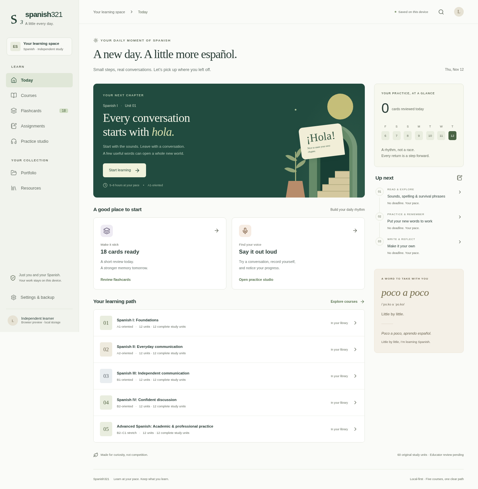

# Spanish321

A calm, local-first Spanish-learning desktop application built with Tauri 2, Rust, React, TypeScript and SQLite. Original curriculum is separate from the UI, with Markdown explanations inside schema-validated JSON.

**Development preview — not a complete 60-unit curriculum or student-ready release.** Spanish I has 12 authored drafts, 183 flashcards and 147 automatically checked quiz items. Courses II–V contain a complete 48-unit syllabus only. Qualified Spanish-educator review has not occurred. See [release gates](docs/RELEASE-GATES.md).



## What works in the preview

- Lesson reader, objectives, original dialogues, worked examples, resources and printable guides.
- Spaced repetition with Again / Hard / Good / Easy, history, daily limits and unit/difficulty filters.
- Multiple choice, single-pair matching, cloze and typed responses; accent-sensitive answers and explanations.
- Separate practice/assessment attempts, local homework, evaluation labels and portfolio.
- Listening/speaking/interaction logs, optional local recording, synthetic voice detection.
- Validated backup/restore and UTF-8 flashcard CSV import/export.
- Responsive interface, keyboard controls, scalable text and light theme.

No account, paid API, server, telemetry, or remote educational page with local command access.

## User installation versus developer setup

There is no signed public application release. A local Debian 13 x86_64 preview installer was built and installed in a network-disabled container; native startup, SQLite persistence, and homework recovery after reopening were smoke-tested. Physical microphone, native exports and full platform accessibility remain unverified. Do not present this limited check as production readiness. Locally built preview artifacts and test limitations are documented in [the review report](docs/CONTENT-REVIEW.md). Read the [user guide](docs/USER-GUIDE.md) for study, privacy and backup instructions.

### Frontend development

Use Node 22.12+ (Node 24 was used here), npm, and the committed lockfile:

```sh
npm ci
npm run validate
npm test
npm run build
npm run preview
```

Open the printed local URL. This is a browser preview using IndexedDB, not the desktop SQLite runtime. `npm run dev` starts development on port 1420. Built assets include a versioned offline cache; no external media is cached.

### Desktop development

Install current stable Rust and the [official Tauri prerequisites](https://v2.tauri.app/start/prerequisites/) for your OS before compiling. On Debian/Ubuntu the documented dependencies include WebKitGTK 4.1, build-essential, libssl-dev, librsvg2-dev, libxdo-dev and libayatana-appindicator3-dev. Windows requires Microsoft C++ Build Tools and WebView2; macOS requires Xcode Command Line Tools. Refer to official documentation for version-specific changes.

```sh
cargo test -p spanish321-core
npm run tauri -- dev
npm run tauri -- build --bundles deb       # Linux Debian package
npm run tauri -- build --bundles appimage  # Linux, requires bundle tooling
npm run tauri -- build --bundles dmg       # macOS host
npm run tauri -- build --bundles nsis      # Windows host
```

Native data is stored in the platform application-data directory, separate from course assets. No credentials are needed. Package signing is not configured.

### Tests and content exports

```sh
npm run validate
npm test
cargo test -p spanish321-core
npm run build
npm run test:e2e
npm run guides
```

Playwright uses installed Chromium by default on this Linux workspace; set PLAYWRIGHT_CHROMIUM_EXECUTABLE to an installed executable or leave it unset on CI to use Playwright’s bundled Chromium. Tests cover offline browser use, reopen persistence, practice/assessment labels, backups, responsive course navigation, grading, scheduling and migration invariants. Browser E2E does not certify native WebKit behavior.

Generated guides and CSVs are in release/ (not committed). `content/unit.schema.json` and `content/backup.schema.json` are generated from `src/schema.ts` by `node --import tsx scripts/schema.ts`.

## Project map

- `src/` — interface, browser adapter and preview learning logic.
- `src-tauri/` — minimal native commands, capability boundary and packaging configuration.
- `crates/learning-core/` — Rust scheduling, grading, SQLite migration/persistence, validation and tests.
- `content/` — syllabus, original unit content, schemas, resource catalog.
- `research/` — dated resource checks and screenshots; page retrieval is distinct from playback.
- `docs/` — [curriculum audit](docs/CURRICULUM.md), [architecture](docs/ARCHITECTURE.md), [licensing proposal](docs/LICENSING.md), user guide and release gates.

The existing GPL-3.0 LICENSE is preserved. A separate CC BY-SA 4.0 license for original educational content is proposed, not activated; confirm before public release. Third-party works retain their own terms and are linked, not redistributed.
